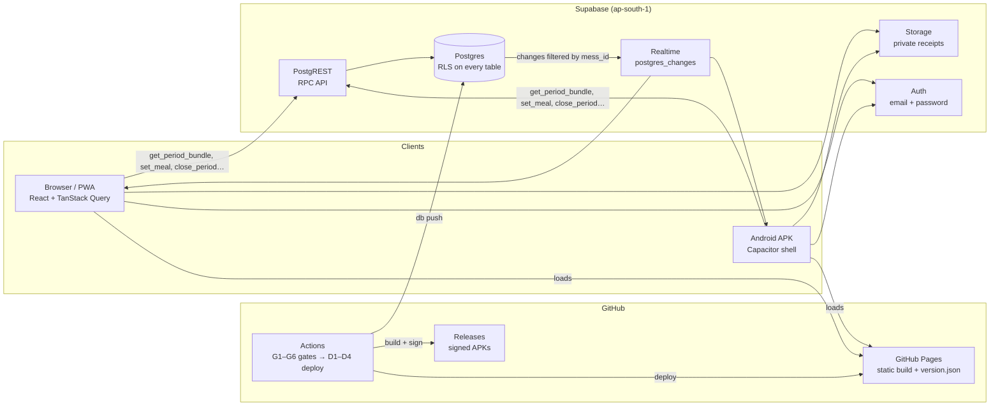

# Light House – Mess Meal Manager

Meals, bazar, bills and month-end settlement for a shared mess. It replaces the mess Google Sheet and reproduces its numbers to the taka. One codebase ships as:

- **Web app / PWA:** https://julfikerhaider2001.github.io/Light-House-Management/
- **Android APK:** [download the latest app](https://github.com/julfikerhaider2001/Light-House-Management/releases/latest/download/light-house.apk) ([all releases](https://github.com/julfikerhaider2001/Light-House-Management/releases)) (signed; it loads the live web app, so every deploy updates phones instantly)
- **Status page:** https://julfikerhaider2001.github.io/Light-House-Management/#/status
- **Month mail runs:** https://github.com/julfikerhaider2001/Light-House-Management/actions/workflows/month-mail.yml

iPhone users install the PWA from Safari (Share → Add to Home Screen).

Everything runs on free tiers: Supabase Free, GitHub Free, GitHub Pages and GitHub Actions.

## Architecture



- **Server-side API.** Each screen reads one RPC (`get_period_bundle`), and multi-row writes are single transactional RPCs (`create_mess`, `join_mess`, `close_period`, `reopen_period`). Reads run as the caller, so RLS applies. See `supabase/migrations/*_api.sql`.
- **One calc engine.** `src/lib/calc` is pure TypeScript using exact rational arithmetic (BigInt). It is the single source of truth for the report, the month emails, the month-close snapshot and the dues carried forward. Two golden fixtures pin it: September 2026 reproduces `report_format/format.tex` exactly (Σ final pay 21 420), and October 2026 matches the old sheet's columns (Σ final 21 413).
- **Live everywhere.** Each mess has one realtime channel, filtered by `mess_id`. Any change refetches the bundle and the activity feed.
- **Security.** RLS is on for every table, with column-level grants. There are no hard deletes (soft delete with Undo) and nothing is readable by anonymous users except `health()`. Every rule is proven by pgTAP across two messes.

## Using it

Everyone in a mess has equal access: any member can add or fix meals, bazar, bills, payments and members. **Manager** is a title that anyone can pass on. Every change is in the activity log, and deletes can be undone.

### Install

- **Android:** [download light-house.apk](https://github.com/julfikerhaider2001/Light-House-Management/releases/latest/download/light-house.apk) and install it (allow installs from your browser if asked). The link always gives the newest build, and the app loads the live site, so it updates itself after every deploy.
- **PC, iPhone or any browser:** open https://julfikerhaider2001.github.io/Light-House-Management/. To install it as an app, use Chrome's install icon in the address bar, or on iPhone, Safari → Share → Add to Home Screen.

### Start a mess and add members

1. Sign up with your name, email, password and a profile photo, then choose **Create mess**.
2. Open **More → Members**.
   - **Invite:** share the link or let people scan the QR code. It opens `#/join/<CODE>`, and after signing up they join your mess.
   - **Add placeholder:** add people before they sign up. When they join with the code, they pick their name and keep its history.
   - **New code** rotates the invite code, for example after someone leaves.
3. From the same screen, anyone can make a member the manager or mark them as left.

Already in a mess? Use **More → Join or create another mess**, then switch between messes from **More**.

### Screens

Every screen has a top bar with the mess name, month, open/closed status and member count, plus a **☀ / ☾ button** that switches between light and dark mode.

| Screen       | What                                                                                                                                                                                                                                                                           |
| ------------ | ------------------------------------------------------------------------------------------------------------------------------------------------------------------------------------------------------------------------------------------------------------------------------ |
| Today        | Four highlighted numbers: **Meal rate**, **My meals**, **To pay** (your final pay this month) and **Due** (what you still owe this month). A red notice shows any unpaid previous due. Below that: everyone's meals for tomorrow in 0.5 steps; set them by the cutoff (22:00). |
| Meals        | Month grid with totals. Tap a cell to change it.                                                                                                                                                                                                                               |
| Bazar        | Add what you paid for, itemised (`murgi-230`), with an optional receipt photo. **Tap an entry to edit it** (amount, items, who paid, date, note). Delete with the bin button or by swiping left; Undo brings it back.                                                          |
| Bills        | Khala, house rent (a fixed share per person, or blank to split the rest), WiFi, gas, electricity, extra, other, and previous dues.                                                                                                                                             |
| Report       | The month's Payment Summary in the format of `report_format/format.tex`: **Final pay summary** first, then **Previous due**, the per-member table (names across the top, items down the side), the notes, and Overview & highlights. Export CSV or print to PDF.               |
| Payments     | Record cash, bKash, Nagad or bank payments, choosing **This month** or **Previous due** for each. Tap a payment to correct it.                                                                                                                                                 |
| Close month  | Meals ✓ → Bazar ✓ → Bills ✓ → Review → Closed. Closing stores a snapshot and moves everything still unpaid into next month's previous due. Reopening needs a reason, which is logged. Also shows whether the month's report email has gone out.                                |
| Appearance   | **More → Appearance:** Dark, Light or Device mode, and six colour themes (Emerald, Ocean, Sunset, Violet, Rose, Gold). Saved on each device.                                                                                                                                   |
| Profile      | Name, phone (for bKash/Nagad), change or **remove** your photo, change password.                                                                                                                                                                                               |
| Import sheet | Upload the old `.xlsx`, check the preview diff, then import.                                                                                                                                                                                                                   |

### How the money works

- **Have to pay** = meal cost − bazar. Meal cost = meals × meal rate, rounded up to the taka; meal rate = total bazar ÷ total meals.
- **Have to pay (init.)** = initial cost rate (total initial cost ÷ members) − what each person paid towards it.
- Khala, WiFi, gas, electricity, other and extra are split equally. House rent uses the fixed shares, and anyone without one splits the rest equally.
- **Sub-total** = have to pay + bills + have to pay (init.), rounded. **Final pay** = sub-total + extra, **rounded up to the next ৳5** (5,329 → 5,330). The report's notes list each person's rounding.
- **Previous due is kept separate.** It is never added into this month's bill, so bazar done this month can't cancel an old due. Pay it off with a payment marked **Previous due**; its status shows _Clear_ once it reaches 0.
- **Closing a month** moves what is still unpaid (this month's final pay minus payments, plus any previous due left) into next month's previous due. A negative amount is a credit.

### Month report emails

Every day at 00:10 (Dhaka time), the [Month mail workflow](https://github.com/julfikerhaider2001/Light-House-Management/actions/workflows/month-mail.yml) does two things:

1. It closes any month that has ended but is still open, exactly like pressing **Close**.
2. It emails every joined member their own report: their final pay and status, their previous due, the full Payment Summary, and Overview & highlights.

A month that is reopened and closed again is emailed again with the corrected numbers. **Close month** also keeps a button for sending the report from your own mail app.

**One-time setup:** in [Settings → Secrets and variables → Actions](https://github.com/julfikerhaider2001/Light-House-Management/settings/secrets/actions), add:

- `SMTP_USER`: the Gmail address the reports are sent from
- `SMTP_PASS`: that account's 16-character [app password](https://myaccount.google.com/apppasswords). 2-Step Verification must be on, and your normal password won't work.

**To test it:** open [Actions → Month mail](https://github.com/julfikerhaider2001/Light-House-Management/actions/workflows/month-mail.yml) → **Run workflow** and tick **dry run**. The log shows which months it would close and who it would email, without changing or sending anything. Then run it again without dry run to do it for real. Until the secrets are set, months still close, but the run fails with a warning that reports are waiting. They are sent on the first run after you add the secrets.

## CI/CD

Every change goes through a pull request. All six gates are **required** on `main`: admins are included, the history is linear, merges are squash-only, and force pushes are blocked.

| Gate              | What it proves                                                                                                                                                                                                       |
| ----------------- | -------------------------------------------------------------------------------------------------------------------------------------------------------------------------------------------------------------------- |
| **G1 Static**     | Prettier, ESLint (0 warnings), `tsc --noEmit`, gitleaks over the full history, `npm audit --audit-level=high`                                                                                                        |
| **G2 Unit**       | Vitest with ≥ 95% coverage on `src/lib/calc/**` (currently 100%), including the golden September-2026 (report format) and October-2026 (sheet) fixtures                                                              |
| **G3 Database**   | Every migration applies from zero, `supabase db lint` reports no errors, pgTAP passes (RLS, RPCs, two-mess isolation), and the generated types match `src/types/database.ts`                                         |
| **G4 Build**      | Production build; `version.json` carries the commit; initial-route JS ≤ 250 KB gzip                                                                                                                                  |
| **G5 E2E**        | Playwright on desktop and mobile against local Supabase: sign up, create a mess, a second user joins, a meal edit and a bazar entry reach the other device live within 3 s, and the report equals the golden fixture |
| **G6 Lighthouse** | Performance ≥ 85, accessibility ≥ 95, best practices ≥ 90, plus Chrome's own PWA installability check                                                                                                                |

A merge to `main` re-runs the gates (`deploy.yml` calls `ci.yml`), then:

- **D1 DB:** `supabase db push --dry-run` (logged), then `db push`, then `config push` if `config.toml` changed
- **D2 Web:** production build to GitHub Pages
- **D3 Smoke:** the live `version.json` must equal the commit, and production `health()` must be healthy. On failure it opens an issue with the logs.
- **D4 Android:** a signed release APK published as `build-<run>`; only the latest 5 releases are kept

Other workflows:

- **Keepalive** (daily) calls `health()` so the free project never pauses.
- **Backup** (weekly) makes an encrypted data dump, kept as an artifact for 30 days.
- **Month mail** (daily, 00:10 Dhaka) closes any month that has ended but is still open, then emails every joined member their own month report (`scripts/month-mail.ts`, using the app's calc engine and RPCs). See [Month report emails](#month-report-emails).
- **Dependabot** checks npm and Actions weekly.

Migrations are forward-only and backward-compatible (expand, then contract), so rolling back means redeploying an earlier commit: **Actions → Deploy → Run workflow**.

### Secrets (GitHub Actions)

`SUPABASE_ACCESS_TOKEN`, `SUPABASE_DB_PASSWORD`, `SUPABASE_PROJECT_ID`, `VITE_SUPABASE_URL`, `VITE_SUPABASE_PUBLISHABLE_KEY`, `BACKUP_PASSPHRASE`, `ANDROID_KEYSTORE_BASE64`, `ANDROID_KEYSTORE_PASSWORD`, `ANDROID_KEY_ALIAS`, `ANDROID_KEY_PASSWORD`, `SMTP_USER`, `SMTP_PASS` (for Month mail; see [Month report emails](#month-report-emails). Optional `SMTP_HOST`/`SMTP_PORT` for a provider other than Gmail).

Only the publishable key reaches the frontend; it is public by design. The secret/service key is never used by the app or stored in the repo. The Android keystore and its passwords are kept offline by the owner; losing them means existing installs can't be updated.

## Restore from a backup

Backups are data-only dumps encrypted with `BACKUP_PASSPHRASE` (AES-256, gpg).

1. **Download** the newest artifact: **Actions → Backup → latest run → `supabase-data-backup`**, or
   ```sh
   gh run download --repo julfikerhaider2001/Light-House-Management -n supabase-data-backup
   ```
2. **Decrypt:**
   ```sh
   gpg --batch --pinentry-mode loopback --passphrase "$BACKUP_PASSPHRASE" \
       -d light-house-data-*.sql.gpg > data.sql
   ```
3. **Create the schema** in the target project, which should be new or empty:
   ```sh
   npx supabase link --project-ref <ref>
   npx supabase db push
   ```
4. **Load the data** with the connection string from the Supabase dashboard (**Connect → Session pooler**):
   ```sh
   psql "<connection string>" -v ON_ERROR_STOP=1 -f data.sql
   ```
5. **Verify:** open `#/status` and check that `health()` is healthy, then spot-check a month's Report.

Restoring into a database that already has rows will conflict on primary keys. Restore into a fresh project, or clear the tables first, and only after deciding that's what you want.

## Local development

```sh
npm ci
cp .env.example .env.local   # point at local or prod Supabase (publishable key only)
npm run dev                  # http://localhost:5173/Light-House-Management/
npm test                     # unit tests (calc, import, formatting)
npx supabase start           # local stack (needs Docker), then: npx supabase test db
npm run e2e                  # Playwright against vite preview + local Supabase
```

UI reference designs live in `design/ui` and are not part of the build.
