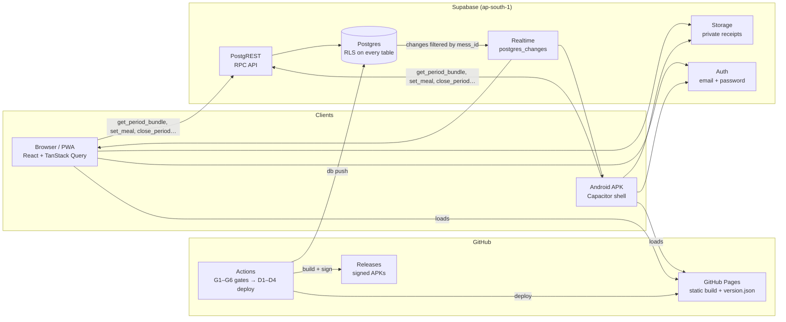

# Light House – Mess Meal Manager

Meals, bazar, bills and month-end settlement for a shared mess. It replaces the mess Google Sheet and reproduces its numbers to the taka. One codebase ships as:

- **Web app / PWA:** https://julfikerhaider2001.github.io/Light-House-Management/
- **Android APK:** [download the latest app](https://github.com/julfikerhaider2001/Light-House-Management/releases/latest/download/light-house.apk) ([all releases](https://github.com/julfikerhaider2001/Light-House-Management/releases)) (signed; it loads the live web app, so every deploy updates phones instantly)
- **Status page:** https://julfikerhaider2001.github.io/Light-House-Management/#/status

iPhone users install the PWA from Safari (Share → Add to Home Screen).

Everything runs on free tiers: Supabase Free, GitHub Free, GitHub Pages and GitHub Actions.

## Architecture



- **Server-side API.** Each screen reads one RPC (`get_period_bundle`), and multi-row writes are single transactional RPCs (`create_mess`, `join_mess`, `close_period`, `reopen_period`). Reads run as the caller, so RLS applies. See `supabase/migrations/*_api.sql`.
- **One calc engine.** `src/lib/calc` is pure TypeScript using exact rational arithmetic (BigInt). It is the single source of truth for the report, the month-close snapshot and the dues carried forward. The golden October-2026 fixture pins it to the sheet: Σ final 21 413, Σ settled 21 410.
- **Live everywhere.** Each mess has one realtime channel, filtered by `mess_id`. Any change refetches the bundle and the activity feed.
- **Security.** RLS is on for every table, with column-level grants. There are no hard deletes (soft delete with Undo) and nothing is readable by anonymous users except `health()`. Every rule is proven by pgTAP across two messes.

## Using it

### Start a mess and add members

1. Sign up, then choose **Create mess**. You become the manager.
2. Open **More → Members**.
   - **Invite:** share the link or let people scan the QR code. It opens `#/join/<CODE>`, and after signing up they join your mess.
   - **Add placeholder:** add people before they sign up. When they join with the code, they pick their name and keep its history.
   - **New code** rotates the invite code, for example after someone leaves.
3. Members can be promoted to manager or marked as left from the same screen.

### Month flow

| Screen       | Who      | What                                                                                                                                                      |
| ------------ | -------- | --------------------------------------------------------------------------------------------------------------------------------------------------------- |
| Today        | everyone | Set your meals for tomorrow in 0.5 steps before the cutoff (22:00 the day before). The manager gets a grid for everyone.                                  |
| Meals        | everyone | Month grid with totals. Members can edit their own future days; the manager can edit any day.                                                             |
| Bazar        | everyone | Add what you paid for, itemised (`murgi-230`), with an optional receipt photo. Swipe left to delete, then Undo.                                           |
| Bills        | manager  | Khala, house rent (fixed shares, or blank to split), wifi, gas, electricity, extra, previous dues.                                                        |
| Report       | everyone | Every sheet column, overview stats and the settlement. Export as CSV or print to PDF.                                                                     |
| Payments     | manager  | Record cash, bKash, Nagad or bank payments; see who still owes.                                                                                           |
| Close month  | manager  | Meals ✓ → Bazar ✓ → Bills ✓ → Review → Closed. Closing stores a snapshot and carries balances into next month. Reopening needs a reason, which is logged. |
| Import sheet | manager  | Upload the old `.xlsx`, check the preview diff, then import.                                                                                              |

**Final** is the sheet-compatible value. **Settled** spreads the sheet's rounding error (its "ERROR / Per ERROR" cells) so the mess balances to the taka. The per-member adjustment is shown on the Report screen.

## CI/CD

Every change goes through a pull request. All six gates are **required** on `main`: admins are included, the history is linear, merges are squash-only, and force pushes are blocked.

| Gate              | What it proves                                                                                                                                                                                                       |
| ----------------- | -------------------------------------------------------------------------------------------------------------------------------------------------------------------------------------------------------------------- |
| **G1 Static**     | Prettier, ESLint (0 warnings), `tsc --noEmit`, gitleaks over the full history, `npm audit --audit-level=high`                                                                                                        |
| **G2 Unit**       | Vitest with ≥ 95% coverage on `src/lib/calc/**` (currently 100%), including the golden October-2026 fixture                                                                                                          |
| **G3 Database**   | Every migration applies from zero, `supabase db lint` reports no errors, pgTAP passes (RLS, RPCs, two-mess isolation), and the generated types match `src/types/database.ts`                                         |
| **G4 Build**      | Production build; `version.json` carries the commit; initial-route JS ≤ 250 KB gzip                                                                                                                                  |
| **G5 E2E**        | Playwright on desktop and mobile against local Supabase: sign up, create a mess, a second user joins, a meal edit and a bazar entry reach the other device live within 3 s, and the report equals the golden fixture |
| **G6 Lighthouse** | Performance ≥ 85, accessibility ≥ 95, best practices ≥ 90, plus Chrome's own PWA installability check                                                                                                                |

A merge to `main` re-runs the gates (`deploy.yml` calls `ci.yml`), then:

- **D1 DB:** `supabase db push --dry-run` (logged), then `db push`, then `config push` if `config.toml` changed
- **D2 Web:** production build to GitHub Pages
- **D3 Smoke:** the live `version.json` must equal the commit, and production `health()` must be healthy. On failure it opens an issue with the logs.
- **D4 Android:** a signed release APK published as `build-<run>`; only the latest 5 releases are kept

Other workflows:

- **Keepalive** (daily) calls `health()` so the free project never pauses.
- **Backup** (weekly) makes an encrypted data dump, kept as an artifact for 30 days.
- **Dependabot** checks npm and Actions weekly.

Migrations are forward-only and backward-compatible (expand, then contract), so rolling back means redeploying an earlier commit: **Actions → Deploy → Run workflow**.

### Secrets (GitHub Actions)

`SUPABASE_ACCESS_TOKEN`, `SUPABASE_DB_PASSWORD`, `SUPABASE_PROJECT_ID`, `VITE_SUPABASE_URL`, `VITE_SUPABASE_PUBLISHABLE_KEY`, `BACKUP_PASSPHRASE`, `ANDROID_KEYSTORE_BASE64`, `ANDROID_KEYSTORE_PASSWORD`, `ANDROID_KEY_ALIAS`, `ANDROID_KEY_PASSWORD`.

Only the publishable key reaches the frontend; it is public by design. The secret/service key is never used by the app or stored in the repo. The Android keystore and its passwords are kept offline by the owner; losing them means existing installs can't be updated.

## Restore from a backup

Backups are data-only dumps encrypted with `BACKUP_PASSPHRASE` (AES-256, gpg).

1. **Download** the newest artifact: **Actions → Backup → latest run → `supabase-data-backup`**, or
   ```sh
   gh run download --repo julfikerhaider2001/Light-House-Management -n supabase-data-backup
   ```
2. **Decrypt:**
   ```sh
   gpg --batch --pinentry-mode loopback --passphrase "$BACKUP_PASSPHRASE" \
       -d light-house-data-*.sql.gpg > data.sql
   ```
3. **Create the schema** in the target project, which should be new or empty:
   ```sh
   npx supabase link --project-ref <ref>
   npx supabase db push
   ```
4. **Load the data** with the connection string from the Supabase dashboard (**Connect → Session pooler**):
   ```sh
   psql "<connection string>" -v ON_ERROR_STOP=1 -f data.sql
   ```
5. **Verify:** open `#/status` and check that `health()` is healthy, then spot-check a month's Report.

Restoring into a database that already has rows will conflict on primary keys. Restore into a fresh project, or clear the tables first, and only after deciding that's what you want.

## Local development

```sh
npm ci
cp .env.example .env.local   # point at local or prod Supabase (publishable key only)
npm run dev                  # http://localhost:5173/Light-House-Management/
npm test                     # unit tests (calc, import, formatting)
npx supabase start           # local stack (needs Docker), then: npx supabase test db
npm run e2e                  # Playwright against vite preview + local Supabase
```

UI reference designs live in `design/ui` and are not part of the build.
